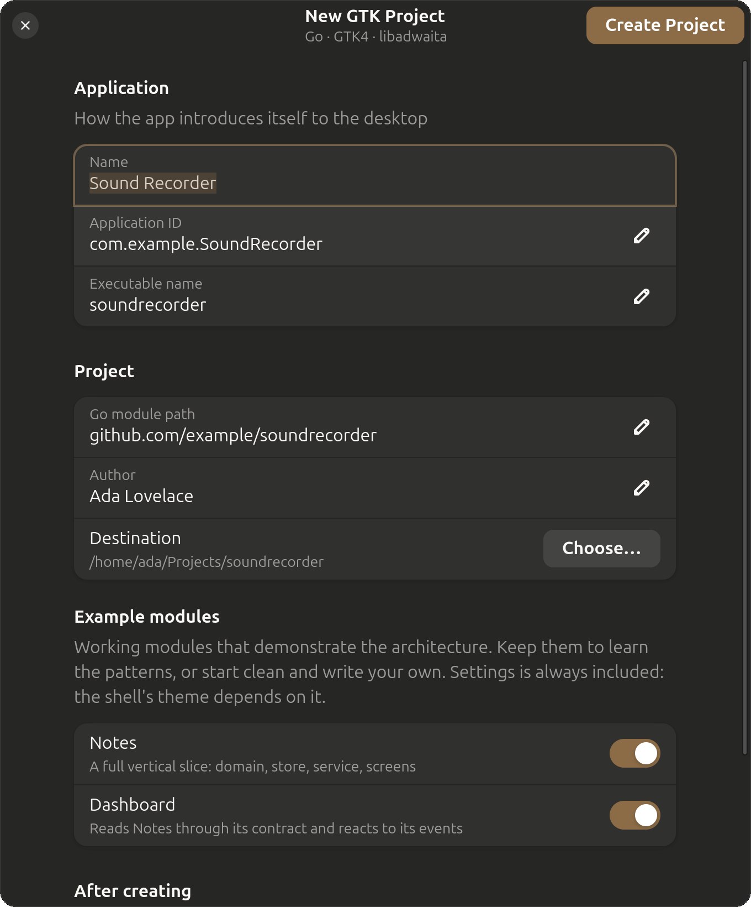

# Joinery

A starting point for Linux desktop applications written in Go, with a GTK4 and
libadwaita interface, arranged as a modular monolith.

One command sets up the toolchain and opens a window that asks what you are
building:

```sh
./setup.sh
```



It installs GTK4, libadwaita and their development headers for your
distribution, checks your Go, builds the wizard, and runs it. What comes out the
other end is a project that compiles, tests and launches before you have written
a line.

The wizard is itself a GTK4 and libadwaita application built on this stack, which
is the first thing it proves: if that window draws on your machine, so will the
one you are about to generate.

Headless, for scripts and CI:

```sh
./setup.sh --batch \
    --name "Sound Recorder" \
    --app-id org.gnome.SoundRecorder \
    --module github.com/you/recorder \
    --dir ~/src/recorder
```

## What you get

A single binary. Inside it, modules that only reach each other through published
contracts, and a linter that fails the build when one of them does not.

```text
cmd/app/                 the composition root: the only file that knows every module
internal/
  app/                   the kernel: the Module contract, the service registry, the shell
  platform/              what every module may use: config, logging, SQLite, event bus, GTK helpers
  modules/
    notes/               an example feature, as a full vertical slice
    settings/            user preferences
    dashboard/           a module built entirely from other modules' contracts
tools/archlint/          the boundary checker
build/                   desktop entry, AppStream metadata, Flatpak manifest
```

Also in the box: SQLite with per-module migrations, an in-process typed event
bus, XDG-correct paths, a Flatpak manifest, a GitHub Actions workflow, and tests
that run without a display.

## The rule the whole thing rests on

A module may reach another module **only through its `api` package**.

```text
internal/modules/notes/ui  ->  internal/modules/settings/api        yes
internal/modules/notes/ui  ->  internal/modules/settings/service    no
```

Everything else a module owns (its domain, its tables, its services, its
screens) is private to it. `make arch` checks this on every build:

```text
archlint: 1 boundary violation(s)

  internal/modules/notes/ui
      imports internal/modules/settings/service
      module "notes" may only reach module "settings" through its api package
```

That check is the difference between a modular monolith and a monolith with
directories in it. Left to code review, one "just this once" import is all it
takes, and a year later the modules are a single knot.

The payoff is that a feature is a directory plus one line in `cmd/app/main.go`,
and removing it is the same edit backwards.

## The stack

| Piece | Choice |
| --- | --- |
| Language | Go 1.25+ |
| Toolkit | GTK 4 and libadwaita 1, through [gotk4](https://github.com/diamondburned/gotk4) |
| Storage | SQLite, via `modernc.org/sqlite`, which is pure Go and needs no second C dependency |
| UI | built in Go, with no Blueprint or GResource step, so `go build` alone works |
| Packaging | Flatpak, `.desktop`, AppStream |

## Requirements

Go 1.25 or newer, and the GTK4 development headers. `./setup.sh` installs the
latter on Debian, Ubuntu, Fedora, Arch and openSUSE. `./setup.sh --check` tells
you where you stand without changing anything.

## Layout of this repository

```text
setup.sh                 the one command
cmd/setup/               the wizard: a GTK window, and a --batch mode for CI
internal/scaffold/       generation: copy the template, rewrite its identity
internal/wizardui/       the wizard's screens
template/                the project template, which is a real, compiling Go module
tools/screenshot/        regenerates the picture above from the running wizard
docs/ARCHITECTURE.md     why the pieces are shaped the way they are
```

The picture at the top is not hand-taken. `tools/screenshot/screenshot.sh` opens
the real wizard and reads the window off the display, so changing the UI and
rerunning it is all it takes to keep the README honest. The script explains, at
some length, why it has to go through XWayland to do that.

`template/` is not a pile of `.tmpl` files. It is a Go module that builds, tests
and runs on its own, and CI proves it on every push. Generation is a copy with a
rename: the template's module path, application ID, name and binary are replaced
with yours, in file contents and in file names alike.

That choice costs one thing. Go will not embed a directory that is a module of
its own, so the wizard reads the template off disk rather than from inside its
own binary. It buys something worth more: a template that cannot silently rot,
because the moment it stops compiling, the build goes red.

## Where to look first

Read [`docs/ARCHITECTURE.md`](docs/ARCHITECTURE.md) for the reasoning, or open
`template/internal/modules/dashboard/`. It is about eighty lines, it owns no
data, and it shows both ways a module is allowed to touch another one.
